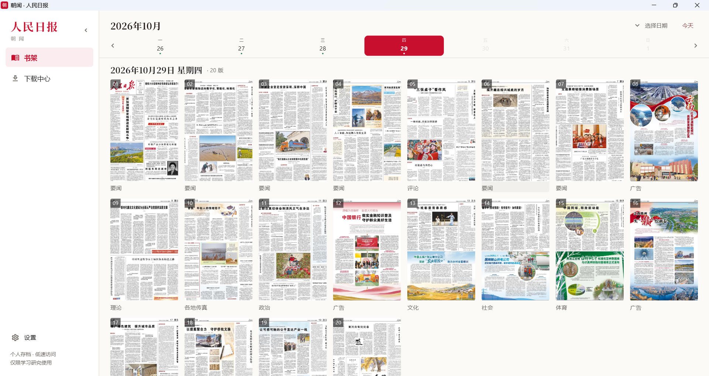
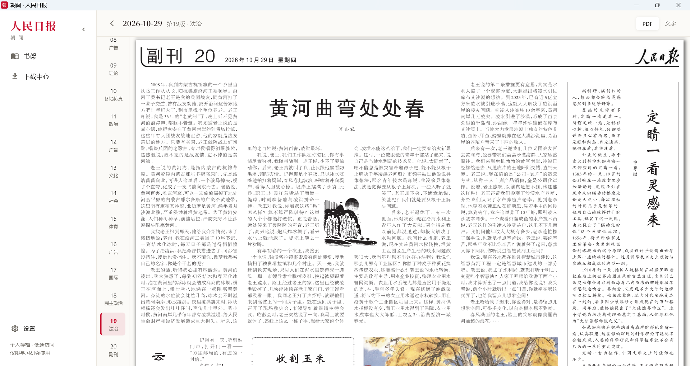
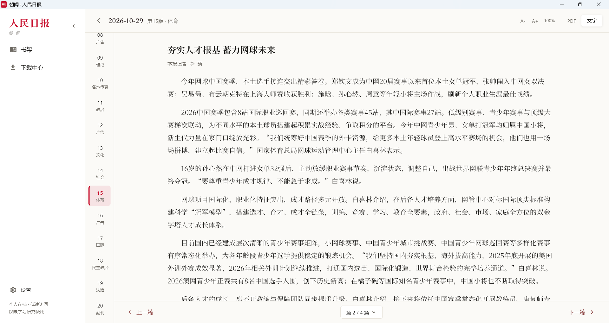

# 朝闻

一个本地新闻阅读器，支持《人民日报》电子版浏览与存档，以及联合早报中国频道的文章阅读。

把《人民日报》电子版变成你自己的报纸库：像翻报纸一样看版面，像读网页一样读正文，需要留档时一键把整期 20 个版合成一个 PDF。

—— 完全本地运行，不需要注册账号，不联网同步任何东西。

  

## 它能做什么

**书架**
按日期浏览报纸，一周七天一屏看全；想过更远的日期，展开完整月历。每期 20 个版面的缩略图一目了然。

**两种阅读方式，随心切换**
- **PDF 模式**：原版版面，广告、图表、排版都和报纸一样
- **文字模式**：纯文字排版，可调字号，一篇文章一屏，翻起来像看电子书

两种模式共用一个阅读位置，看到第二版切过去还是第二版。

<table>
  <tr>
    <td width="50%"></td>
    <td width="50%"></td>
  </tr>
  <tr>
    <td align="center">PDF 模式：原版版面，广告图表都在</td>
    <td align="center">文字模式：可调字号，一篇一屏</td>
  </tr>
</table>

**下载与存档**
- 单独下载某一天，或按日期区间批量下载
- 下载中可以随时暂停、继续、取消
- 每期自动合并成一个**带书签的 PDF**，翻页时能直接跳转版面
- 单版图片在合并后自动清理，不占双份空间
- 深色模式，夜里看不刺眼

**联合早报中国频道**
- 侧栏点击「联合早报」，读取 `www.zaobao.com/news/china` 当前页面的文章列表
- 首页采用与人民日报一致的纸色、宋体和轻量控件，头条区与分栏目录呈现新闻
- 滚动至底部自动加载更早的文章，也可点击「加载更早的文章」；列表与页码仅在当前会话内保留
- 点击文章，在朝闻内阅读提取后的文字和图片，可调字号、切换深浅主题
- 正文按需获取，文字与图片仅驻留内存，不写入早报内容缓存；图片缺失不影响文字
- 手动刷新最新列表，使用官网中国频道的同一分页来源加载旧文章；不递归抓取相关阅读或其他频道
- 标题下统一不显示摘要；支持会话内已读标记、任务取消和重新提取文章
- 每次重新进入联合早报均清空上一会话并请求最新列表，刷新失败时显示错误
- 遇到访问限制或预览会明确提示，可通过「原文」在系统浏览器查看

早报功能使用本机直接请求 `.com`，不主动切换到 `.com.sg`；不需要登录朝闻账号，不采集早报账号或 Cookie。它是网页文章阅读，不提供早报电子报 PDF 或历史整期下载。

## 安装

**下载**：[最新版本](https://github.com/mysilicons/chaowen/releases/latest) → 下载 `朝闻-x.x.x-setup.exe`（约 54 MB）→ 双击安装。

- 默认装到当前用户目录，**不需要管理员权限**
- 安装位置可自选，也可以选择「为所有用户安装」
- 可选是否创建桌面快捷方式
- 装完可直接启动

> **首次运行被 Windows 拦了？**
> 安装包没有代码签名，SmartScreen 可能提示「已保护你的电脑」。点 **更多信息 → 仍要运行** 即可。这是未签名软件的常规提示，不是报毒。

**卸载**：控制面板 →「朝闻」→ 卸载。卸载只删程序，**不会**删你下载的报纸和缓存。

## 三分钟上手

1. **第一次打开**会有一个简短引导，确认下载目录（默认「文档 / 人民日报」）
2. **在书架上点日期**，下方出现这一期的 20 个版面
3. **点任意版面**进入阅读，右上角可在 PDF / 文字之间切换
4. **想存档**：点右下角红色下载按钮，等进度条走完，整期 PDF 就出现在下载目录里

## 常见问题

**下载为什么这么慢？**
人民日报访问默认为 1 个下载任务、每秒 2 个请求，一期 20 个版大约 40 次请求、45 秒左右。联合早报已移除旧版固定 10 秒等待：正文／列表默认请求间隔 0.5 秒；正文提取完成即显示，图片由阅读界面直接按需加载，不等待图片下载或写入磁盘。网络仍可能影响实际速度，遇到 429 会遵守服务端等待要求。

**一期占多少空间？**
大约 60 MB（含广告版）。下载一年约 18 GB，建议提前留好磁盘。

**文件存在哪里？**

| 内容 | 位置 |
| --- | --- |
| 下载的报纸（PDF） | `文档\人民日报\2026\2026-10-29\` |
| 缓存与设置 | `%LOCALAPPDATA%\rmrb-reader` |

下载目录可以在**设置 → 存储**里改。注意：换目录只影响之后的下载，已下载的文件不会自动搬过去。

联合早报的列表、正文、图片、页码和已读状态不持久化。重新进入来源会重新请求；旧版早报数据库表和 `zaobao/` 图片缓存会在升级启动时清除，人民日报存档和设置保留。历史版本已生成的数据库备份不自动删除。

程序自动写入诊断日志，位置为 `%LOCALAPPDATA%\rmrb-reader\logs`，可从「设置 → 诊断日志」或早报页「日志」打开。前端和引擎各保留 3 份、每份最多 1 MiB，原生崩溃日志保留 2 份、每份最多 256 KiB，总上限约 6.5 MiB。日志不记录新闻正文、标题、摘要、Cookie 或请求鉴权值；详见 [会话与日志说明](docs/联合早报-无持久化与诊断日志.md)。

**能看多久以前的报纸？**
2024-12-01 之后（那之后站点才改版）。更早的旧站结构不同，暂不支持。

**切日期为什么这么快？**
看过的日期会把版面目录存在本地。但**当天**的报纸每次都会重新获取，因为白天可能有版面更新。

**支持 Mac / Linux 吗？**
目前只做了 Windows 10 / 11（64 位）。

**能导出单篇文章吗？**
暂不支持。现在的定位是整期归档 —— PDF 已经是完整的。

## 系统要求

Windows 10 / 11（64 位），约 200 MB 磁盘空间，安装后无需联网即可阅读已下载内容。

## 免责声明

- 本项目为**个人开发的独立软件**，与人民日报社、人民网股份有限公司**没有任何关联**，未获其授权、认可或赞助。
- 本项目同样与联合早报及新报业媒体没有关联；内容来源名称仅用于说明支持的阅读来源，内容权利归相应权利人所有。
- 项目中不包含任何报纸内容、图片或 PDF；所有内容均由使用者在本地自行获取，作者不存储、不转发、不提供下载源。
- 「人民日报」为权利人的商标/名称，本项目仅以**说明性方式**提及所支持的报纸，不用于标识商品来源。
- 使用本软件所产生的一切后果由使用者自行承担；作者不对因使用本软件引起的任何直接或间接损失负责。

## 使用须知

请把本工具用于**个人学习与研究的本地存档**。

- 程序以极低速率访问站点，不提供分享、镜像、对外分发功能
- 《人民日报》（电子版）版权归人民网股份有限公司所有，其声明为「仅供人民网读者阅读、学习研究使用」
- 请勿将本工具用于批量分发、镜像建站或商业用途，使用方式需自行确保合法合规

## 许可证

[MIT License](LICENSE) © 2026 mysilicons

字体为**思源宋体**，遵循 [SIL Open Font License 1.1](fonts/OFL.txt)。

---

想从源码构建、了解架构或参与开发？见 [开发说明](docs/development.md)。
